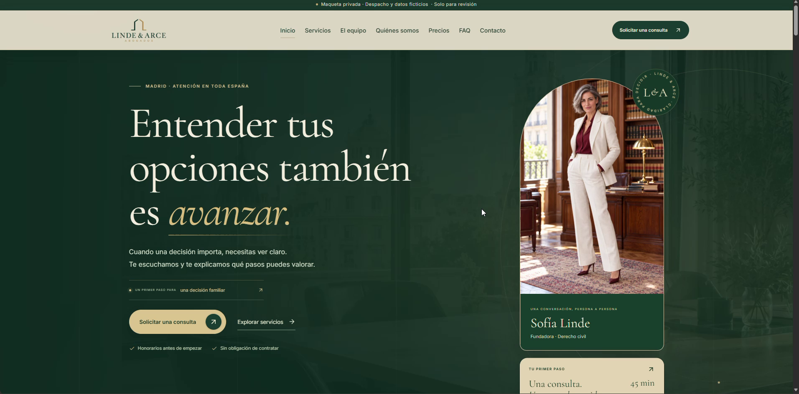
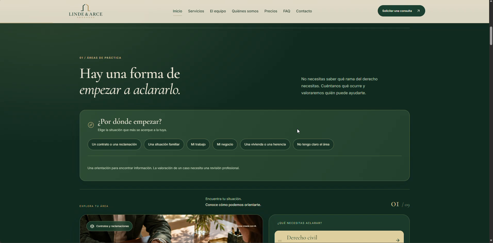
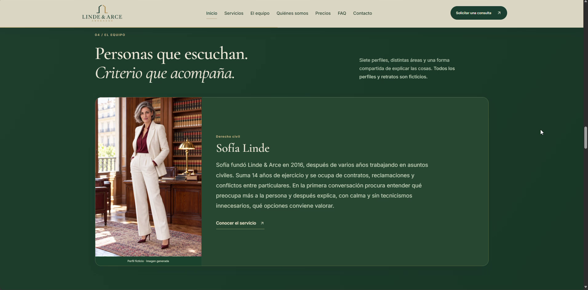
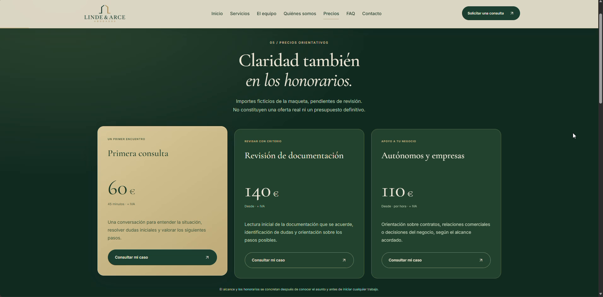
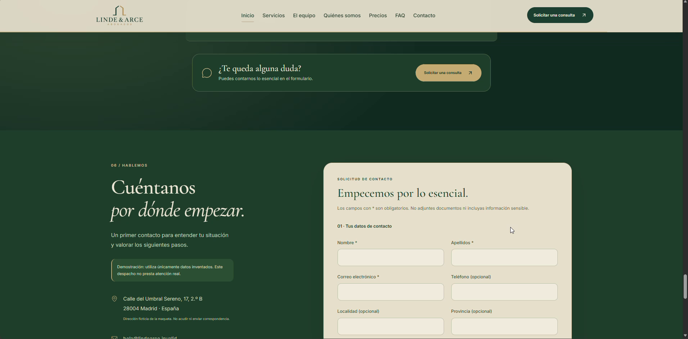

# Linde & Arce Abogados

### Una web para entender por dónde empezar cuando aparece un problema legal

Imagina que recibes un contrato y hay una cláusula que no entiendes. Quizá tienes que firmarlo pronto. Buscas ayuda, pero tampoco sabes si tu duda corresponde a derecho civil, mercantil o a otra especialidad.

En Linde & Arce puedes empezar por **«Un contrato o una reclamación»**. La web te lleva al área civil, explica qué asuntos trata y presenta a Sofía Linde, la profesional de ese servicio en la historia. Antes de escribir, puedes leer cómo sería el primer contacto y consultar el precio de ejemplo de una primera reunión: **60 € + IVA por 45 minutos**. Después, un formulario te permite contar lo esencial sin enviar documentos sensibles.

Ese recorrido muestra qué es Linde & Arce: **un despacho de abogados generalista imaginado para este proyecto**, con una web diseñada alrededor de las preguntas del cliente y escrita con palabras cercanas. El despacho, su equipo, su trayectoria, los precios, las opiniones y los datos de contacto son ficticios. La solicitud de la maqueta es una prueba; nadie ofrece atención jurídica real desde este portfolio.

**[Abrir el portfolio y ver el vídeo](https://unai-598.github.io/portfolio-linde-arce-abogados/)** · [Ver las 13 capturas](CAPTURAS.md)

## El objetivo

Una persona que llega con una duda debe poder encontrar el área que se parece a su caso, conocer a quien aparece al frente de ella y entender el posible coste antes de escribir. El diseño busca hacer ese recorrido claro sin simplificar en exceso asuntos que necesitan una revisión profesional.

## El despacho dentro de la historia

Linde & Arce tiene una sede ficticia en Madrid centro. La historia comienza en **2016**, cuando Sofía Linde funda el despacho con una idea que recorre toda la web: escuchar, poner orden en los hechos y explicar las opciones antes de pedir una decisión. En **2019** se incorpora el área de familia; en **2022**, la de derecho mercantil; y en **2025**, la atención a distancia se extiende a toda España.

La web se dirige a **particulares, autónomos y pequeñas empresas**. Una persona puede necesitar ayuda con una herencia o una separación. Un autónomo quizá quiere revisar un contrato comercial. Una empresa puede tener dudas sobre un despido, un acuerdo entre socios o una sanción administrativa. La navegación parte de esas situaciones y permite llegar a una página específica, con información suficiente para preparar una primera conversación.

## Qué asuntos aparecen en la web

Hay **nueve áreas de práctica**. Cada una tiene su propia página con una explicación inicial, asuntos frecuentes, posibles pasos y preguntas que suelen surgir antes de consultar.

| Área | Ejemplos de asuntos |
| --- | --- |
| Derecho civil | Contratos, pagos pendientes y desacuerdos entre particulares. |
| Derecho de familia | Separaciones, convenios y cambios en medidas familiares. |
| Derecho penal | Denuncias, citaciones y fases de un procedimiento. |
| Derecho mercantil | Contratos comerciales y acuerdos entre socios. |
| Derecho laboral | Despidos, salarios y acuerdos de trabajo. |
| Derecho administrativo | Notificaciones, sanciones, alegaciones y recursos. |
| Inmobiliario y alquileres | Compraventas, arrendamientos y conflictos sobre inmuebles. |
| Sucesiones | Testamentos, herencias y particiones. |
| Extranjería y consumo | Trámites y reclamaciones que requieren estudiar el caso concreto. |

## Las personas que presenta la maqueta

Cada perfil explica qué asuntos atiende y cómo empezaría a trabajarlos. **Los siete nombres, biografías y retratos son ficticios**; las imágenes se crearon para el proyecto y no muestran a abogados reales.

| Profesional | Área en la historia |
| --- | --- |
| Sofía Linde | Civil y fundación del despacho. |
| Marc Arce | Familia. |
| Irene Vela | Penal. |
| Daniel Ríos | Mercantil y negocio. |
| Lucía Ferrer | Laboral. |
| Tomás Beltrán | Administrativo y extranjería. |
| Elena Salvat | Sucesiones e inmobiliario. |

## Lo que puede hacer una persona al entrar

1. **Empezar por su situación.** El explorador ofrece opciones como «Mi trabajo», «Mi negocio» o «Una vivienda o una herencia». También permite continuar sin saber el área jurídica.
2. **Profundizar sin perderse.** Cada servicio abre una página dedicada, con ejemplos de asuntos, preguntas frecuentes y el perfil relacionado.
3. **Entender el siguiente paso.** La web explica cómo se plantea una consulta y muestra honorarios orientativos de la maqueta antes de pedir datos.
4. **Contar lo esencial.** El formulario de prueba pide un resumen inicial y recuerda que no se envíen documentos ni información especialmente sensible.

## Cómo construí este caso

Definí la estructura y el contenido, desarrollé la maqueta con ayuda de ChatGPT Sites y la revisé pantalla a pantalla. Ajusté la navegación, las páginas de servicio, el tamaño de los textos, los retratos, las imágenes asociadas a cada área y el formulario. La identidad visual combina verde profundo, crema, acentos dorados y una tipografía editorial para transmitir calma sin dificultar la lectura.

La presentación pública reúne un **vídeo editado de 2:43** y **13 capturas PNG de 1912 × 944 píxeles** extraídas de la grabación original. Muestran la web funcionando en local. La web del despacho no tiene una demo pública interactiva verificada; este portfolio permite conocerla mediante el recorrido y las pantallas.

| Explorar servicios | Conocer al equipo |
| --- | --- |
|  |  |

| Consultar precios | Llegar al formulario |
| --- | --- |
|  |  |

**[Ver el vídeo y el portfolio visual](https://unai-598.github.io/portfolio-linde-arce-abogados/)** · [Recorrer todas las capturas](CAPTURAS.md) · [Leer las decisiones de diseño](PROYECTO.md)

---

*Proyecto de portfolio ficticio · Octubre de 2026*
